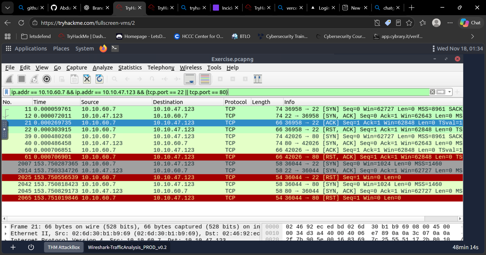
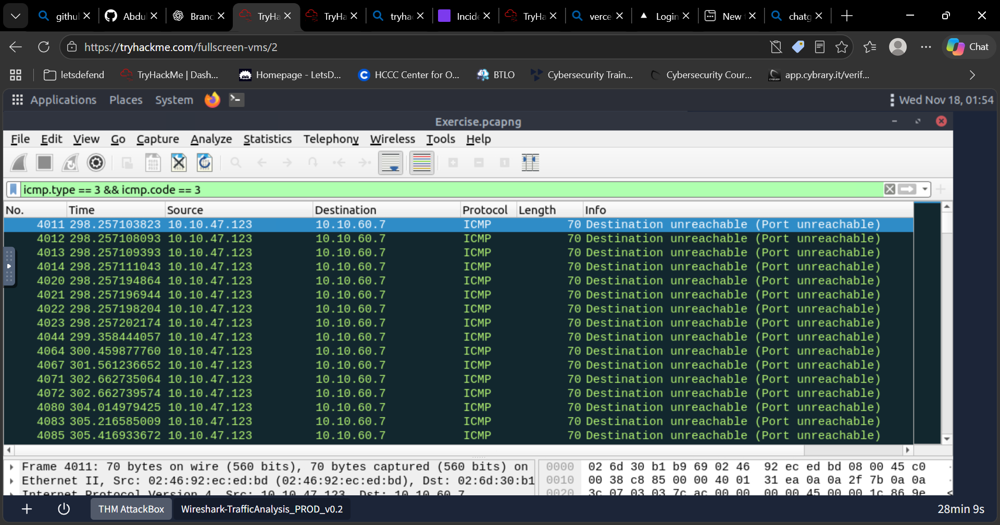
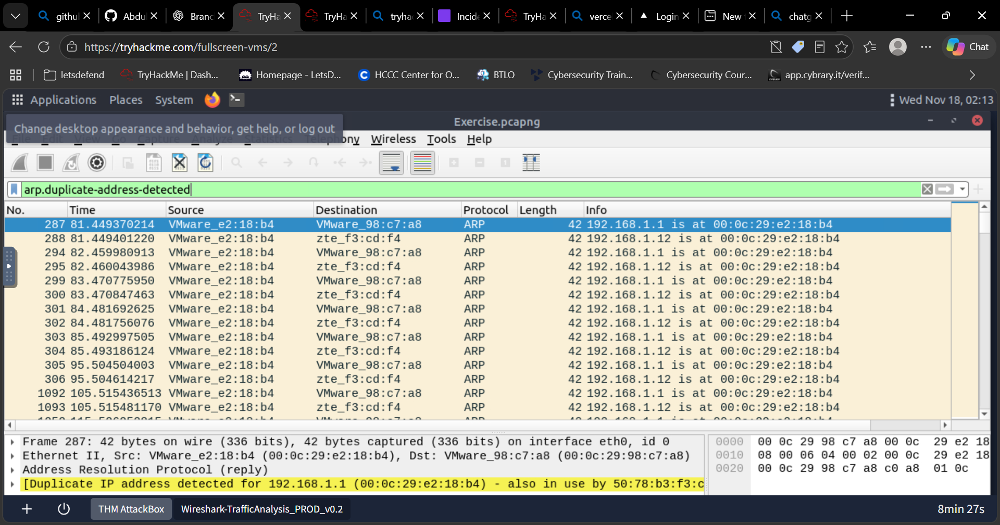
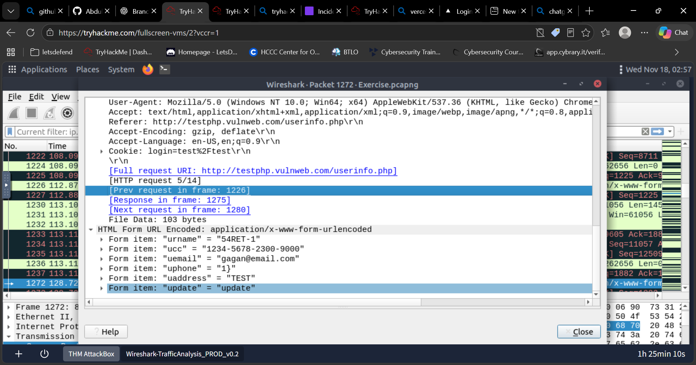
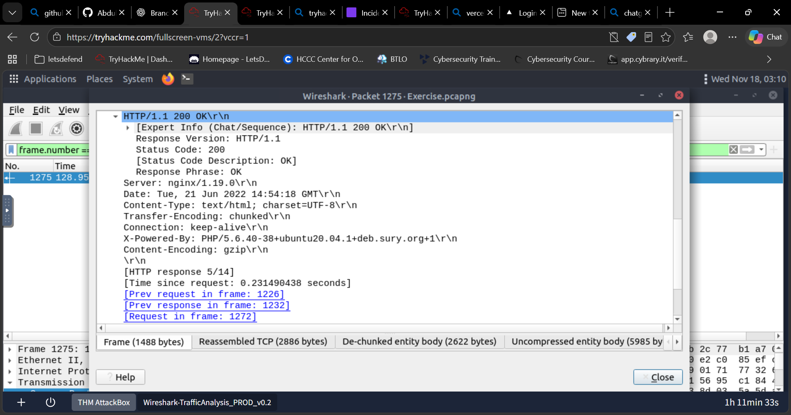
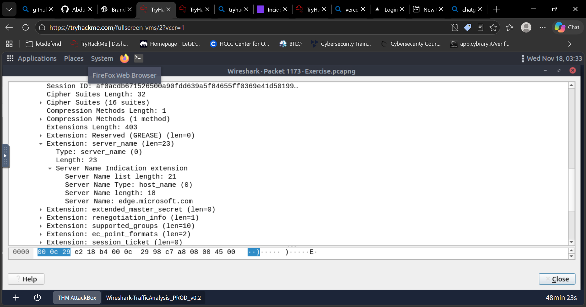
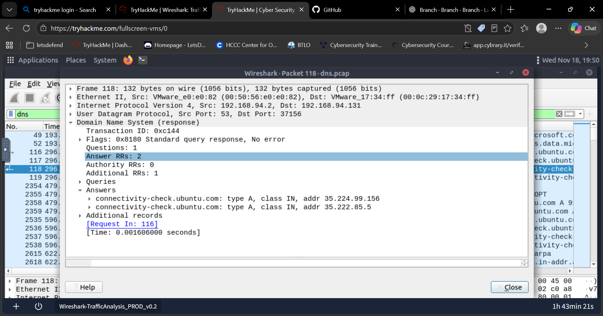
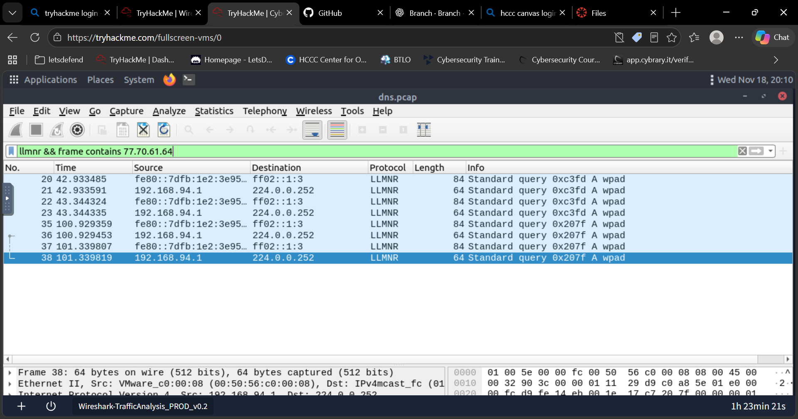

# Wireshark Network Traffic Analysis

## Project Overview

This project demonstrates practical network traffic analysis using Wireshark and packet capture (PCAP) files in a cybersecurity lab environment.

The objective was to examine network communications, identify network protocols, investigate potentially suspicious traffic patterns, and understand security risks.

This project focuses on practical technical skills relevant to a Tier 1 Security Operations Center (SOC) Analyst.

## Project Objectives

- Analyze TCP and UDP network traffic.
- Identify network scanning patterns.
- Examine ARP traffic and potential IP conflicts.
- Investigate HTTP requests and possible sensitive data exposure.
- Inspect HTTPS connections and TLS handshakes.
- Analyze DNS queries and responses.
- Examine LLMNR and WPAD name-resolution traffic.
- Apply Wireshark display filters.
- Document technical findings using packet-level evidence.

## Tools and Technologies

- Wireshark
- PCAP / PCAPNG
- Nmap
- TCP/IP
- ARP
- DNS
- HTTP / HTTPS
- TLS
- LLMNR
- mDNS

---

## Investigation and Technical Evidence

This project contains eight selected screenshots documenting practical network traffic analysis activities.

### 1. TCP Scan Patterns

**Evidence:** `01-Nmap-TCP-Scan-Patterns.png`

**Analysis:**
Examines TCP scanning patterns and packet behavior to understand how network reconnaissance can identify accessible services.

**Security relevance:** TCP scanning analysis helps SOC analysts recognize potential reconnaissance activity.

### 2. UDP Port Unreachable

**Evidence:** `02-Nmap-UDP-Port-Unreachable.png`

**Analysis:**
Examines UDP traffic and ICMP Port Unreachable responses.

**Security relevance:** ICMP responses can help identify closed UDP ports and understand network service availability.

### 3. ARP Duplicate IP / Spoofing Indicators

**Evidence:** `03-ARP-Duplicate-IP-Spoofing.png`

**Analysis:**
Examines ARP traffic to identify potential duplicate IP addresses or unusual address-resolution behavior.

**Security relevance:** Unusual ARP activity may indicate IP conflicts or possible ARP spoofing. Further investigation is required before confirming an attack.

### 4. HTTP POST Sensitive Data Exposure

**Evidence:** `04-HTTP-POST-Sensitive-Data-Exposure.png`

**Analysis:**
Inspects HTTP POST requests and examines the potential exposure of information transmitted through HTTP.

**Security relevance:** Unencrypted HTTP traffic may expose sensitive information to anyone capable of monitoring the network.

### 5. HTTP 200 OK Server Response

**Evidence:** `05-HTTP-200-OK-Server-Response.png`

**Analysis:**
Examines HTTP server responses, including the HTTP 200 OK status code.

**Security relevance:** Understanding HTTP responses helps analysts investigate web communication and identify unexpected server behavior.

### 6. HTTPS TLS Client Hello and SNI

**Evidence:** `06-HTTPS-TLS-Client-Hello-SNI.png`

**Analysis:**
Inspects TLS Client Hello packets and Server Name Indication (SNI) information.

**Security relevance:** TLS handshake inspection helps analysts understand encrypted connection establishment and identify the requested hostname when SNI is available.

### 7. DNS Query and Response Analysis

**Evidence:** `07-DNS-Query-Response-Analysis.png`

**Analysis:**
Examines DNS queries and responses, requested domain names, and returned IP addresses.

The investigation includes DNS resolution activity involving connectivity-check.ubuntu.com.

**Security relevance:** DNS analysis helps SOC analysts investigate domain resolution, identify unusual requests, and examine potentially suspicious DNS activity.

### 8. LLMNR and WPAD Queries

**Evidence:** `08-LLMNR-WPAD-Queries.png`

**Analysis:**
Examines LLMNR name-resolution requests and WPAD-related network traffic.

The captured packets show WPAD name-resolution requests using LLMNR.

**Security relevance:** LLMNR and WPAD traffic can introduce security risks in certain network configurations. These protocols are worth investigating when analyzing possible name-resolution attacks.

---

## Wireshark Display Filters

The following display filters were used during the investigation.

| Purpose | Wireshark Filter |
|---|---|
| DNS traffic | `dns` |
| DNS queries | `dns.flags.response == 0` |
| DNS responses | `dns.flags.response == 1` |
| LLMNR traffic | `llmnr` |
| mDNS traffic | `mdns` |
| TLS Client Hello | `tls.handshake.type == 1` |

## Skills Demonstrated

- Network traffic analysis
- Packet inspection
- TCP and UDP analysis
- Network reconnaissance detection
- ARP traffic investigation
- DNS query and response analysis
- HTTP and HTTPS inspection
- TLS handshake analysis
- LLMNR and WPAD investigation
- Wireshark display filtering
- Technical documentation

## Security Relevance

Network traffic analysis is an important skill for Security Operations Center (SOC) analysts.

Understanding normal network behavior helps analysts:

- Investigate unusual network communications.
- Identify potential reconnaissance activity.
- Examine suspicious DNS requests.
- Recognize potentially exposed information.
- Investigate network protocols and security events.
- Document technical observations for further investigation.

Network indicators must always be evaluated in context. An unusual packet or request alone does not prove that a system has been compromised.

## Lab Environment

**Platform:** TryHackMe  
**Primary Tool:** Wireshark  
**Environment:** Hands-on cybersecurity training lab  
**Evidence:** Eight selected investigation screenshots

All activities were conducted for educational purposes.

## Conclusion

This project demonstrates practical experience analyzing network traffic using Wireshark.

Through eight selected technical evidence captures, I documented different network protocols, examined communication patterns, applied display filters, and investigated potential security risks.

These practical exercises helped develop foundational network investigation skills relevant to an entry-level SOC Analyst position.

---

**Project Category:** Cybersecurity / Network Security  
**Project Focus:** Network Traffic Analysis  
**Primary Tool:** Wireshark  
**Target Role:** SOC Analyst Tier 1
